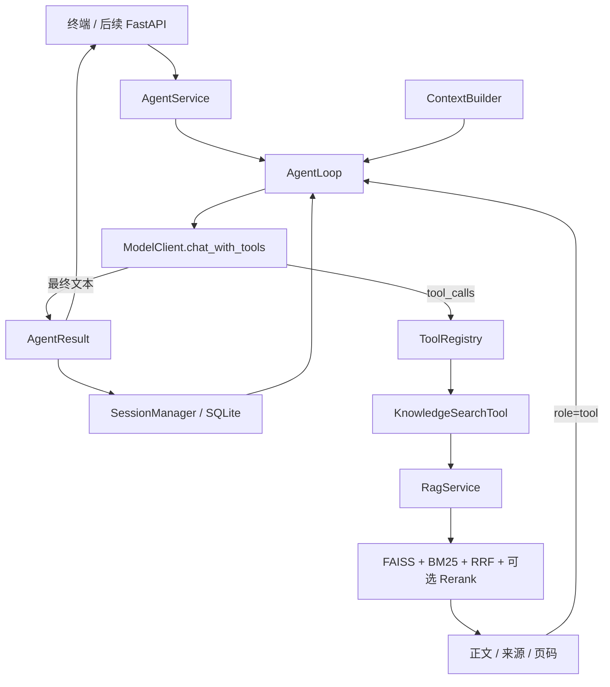

# 私人助理 Agent 架构：参考 NanoClaw

## 设计目标与参考范围

参考本机项目 `C:/Users/Think/Documents/Codex/2026-10-09/gei/outputs/nanoclaw_agent` 的执行结构，采用 AgentLoop、ContextBuilder、ToolRegistry、SessionManager 四个核心组件。模型访问复用已存在的 `app/llm/`；知识查询复用 `app/tools/knowledge.py` 和 `RagService`。不复制参考项目的密钥配置、环境、历史会话或私有记忆。

这一版实现单 Agent 的工具调用循环：模型可以直接回答，也可以多次调用知识工具后回答。采用原生 Function Calling 表达工具请求，不解析自然语言中的 Thought/Action 文本。保持原有 .env 的 LLM_*、EMBEDDING_*、RERANK_* 配置，不增加另一套配置文件，不引入新的 Agent 框架依赖。

## 与参考项目的对应关系

| NanoClaw 原组件 | 当前项目落点 | 处理方式 |
|---|---|---|
| agent/loop.py / AgentLoop | app/agent/loop.py | 模型—工具闭环、调用配对、迭代限制、失败不落库 |
| agent/context.py / ContextBuilder | app/agent/context.py | 动态时间、系统约束、历史完整轮次及本轮工具结果 |
| identity.md | identity.md + app/agent/prompts.py | 项目根目录身份文件每轮读取；系统安全边界仍由代码提示词定义 |
| agent/tools/base.py | app/tools/base.py | Tool 抽象基类与 Function Calling 定义 |
| agent/tools/registry.py | app/tools/registry.py | 工具注册、按名称路由、结构化错误与结果 |
| providers/base.py | app/llm/responses.py | ToolCall、ModelReply 数据类型，隔离 SDK 对象 |
| providers/openai_compat.py | app/llm/client.py | 复用官方 SDK 适配器，新增 chat_with_tools |
| session/manager.py / JSONL | app/agent/session.py / SQLite | 沿用本项目 SQLite 存储策略，原子保存完整成功轮次 |
| main.py / CLIChannel | app/agent/__main__.py | 交互与单次提问入口 |
| filesystem/web/weather/time 工具 | app/tools/ | 工作区文件、Tavily 搜索与网页抓取、心知天气和当前时间工具 |
| compression.py | app/agent/compression.py | 工具清理、会话摘录、主动摘要和超限后恢复 |
| skills/ | app/agent/context.py | 当前注入长期记忆 SKILL.md；通用技能发现和按需读取仍待实现 |
| memory/MEMORY.md | app/agent/memory.py / SQLite | 显式记忆 CRUD，按 owner 跨会话复用，并由 Agent 工具管理 |
| bus/、gateway.py、channels/feishu.py | 后续多渠道接入层 | FastAPI 与 Gradio 已接入 AgentService |

## 目录与依赖方向

```text
app/
├── agent/
│   ├── __main__.py      终端参数与交互
│   ├── service.py       组装依赖，供终端与后续 API 共用
│   ├── loop.py          AgentLoop、AgentResult
│   ├── context.py       系统提示、长期记忆与历史组装
│   ├── compression.py   四层压缩与 token 预算
│   ├── memory.py        长期记忆 CRUD
│   ├── prompts.py       中文 Agent 规则（身份细节在项目根 identity.md）
│   └── session.py       SQLite 会话读写、提交版本检查
├── tools/
│   ├── base.py          Tool 契约
│   ├── registry.py      工具注册与路由
│   ├── knowledge.py     KnowledgeSearchTool + 已有 knowledge_search 函数
│   ├── history.py       当前会话历史分页回查
│   ├── time.py          当前时间与 IANA 时区
│   ├── memory.py        长期记忆管理工具
│   ├── web.py           Tavily 网页搜索（需要 TAVILY_API_KEY）
│   ├── web_fetch.py     公网网页正文抓取与清理
│   ├── weather.py       心知天气
│   └── code.py          代码执行尚未实现
├── llm/
│   ├── client.py        原有 embed/chat/rerank + chat_with_tools
│   └── responses.py     模型回复和工具调用数据类型
├── rag/                 原有知识处理、索引、检索与业务元数据
└── api/                 聊天、知识库、记忆与会话路由
```



Agent 不直接导入 FAISS、切块器或 RAG 数据库模型；知识工具只消费 RAG 公共接口；共享模型层不反向依赖 Agent。RAG 的 ingest、search、ask 和 db 命令继续保留。

## 一次提问的完整流程

1. AgentService 校验问题和 session_id，使用 LLM 配置创建聊天客户端。
2. SessionManager 读取该会话检查点、检查点后的完整轮次及当前版本。
3. ContextBuilder 每轮读取根目录 identity.md，并组合系统约束、Asia/Shanghai 当前时间、应用允许的知识库、SQLite 长期记忆、会话摘要、历史轮次与用户问题。
4. AgentLoop 将工具 JSON Schema 一并发送给模型。
5. 如果返回工具请求，先追加 assistant.tool_calls，再按顺序执行工具，将每个结果用 tool_call_id 配对回填。
6. 模型看到结果后，可以继续检索或直接输出最终文本。知识工具内部不会调用聊天模型。
7. 有效最终回答产生后，一次事务保存本轮用户消息、assistant 工具请求、tool 结果和最终答案。
8. 返回 AgentResult；异常、工具循环熔断或迭代耗尽时，本轮不写入会话。

工具本身报错时会返回 ok=false，模型仍可解释失败后正常完成一轮；这与模型请求异常导致整个轮次未完成不同。

## 模型与工具契约

ModelClient.chat_with_tools 返回 ModelReply：content、tool_calls 和兼容服务可能要求回传的 reasoning_content。ToolCall 保存调用 ID、工具名与原始 JSON 参数。参数解析错误交由注册表反馈，方便模型纠正；reasoning_content 不在终端或 AgentResult 展示。

原有 ModelClient.chat 返回纯文本，供独立 RAG 问答使用，embed 和 rerank 协议保持原样。当前模型需要支持 Chat Completions 工具调用；仅支持普通聊天的模型尚不能运行这个 Agent。离线 SDK 协议测试不能代替真实提供商联调。

KnowledgeSearchTool 的参数：

| 参数 | 约束 |
|---|---|
| query | 1～2000 字符的明确检索问题 |
| knowledgebase | 应用侧传入知识库列表中的一个 |
| top_k | 1～8 的整数，默认 4 |

mode 和 rerank 由应用或 CLI 决定，不接受模型自行改写。注册表拒绝未知工具、非法 JSON、非对象参数及非有限数值；实际工具继续验证业务约束。允许知识库列表属于应用配置，不能替代多用户系统中的身份认证和授权。

工具结果统一使用成功信封 `{"ok": true, "data": ...}`，失败使用 `{"ok": false, "error": ...}`。无匹配资料是 count=0、sources=[] 的成功查询；接口失败是 tool_failed。失败不回传原始异常正文，只保留异常类型。单个输出超过 24000 字符会反馈 tool_output_too_large，避免截断 JSON 或悄悄删除引用正文。

## 引用与回答

RAG 原始编号 S1 只在一次查询中有效。Agent 在回填时转换为 `T轮次-C调用序号-S片段序号`，例如 `[T2-C1-S3]`，避免同一会话多次检索出现同名引用。

AgentResult 含 session_id、answer、sources、model_calls、tool_calls。sources 列出答案实际引用且在可见工具消息中找到的证据，包含片段 ID、文件名、物理页码、分数、知识库和索引版本；不重复返回正文。模型未引用的片段不会列入 sources。

引用规则通过提示词约束；本版不会自动证明回答被来源支持，也不会保证模型绝不编造文本编号。验收仍需核对答案与原文，后续可加入引用完整性校验和标注集评估。

## SQLite 与会话一致性

使用原有 `data/assistant.db`，新增表在第一次 Agent 会话访问时创建：

| 表 | 关键字段 | 用途 |
|---|---|---|
| agent_turns | session_id、turn_number、messages_json、created_at | 一个完整成功轮次一行 |
| agent_checkpoints | session_id、through_turn、summary、sources_json | 成功压缩检查点 |
| agent_memories | owner_id、memory_key、content、updated_at | 用户显式保存的长期记忆 |
| agent_session_owners | session_id、owner_id | 会话归属隔离 |

原 RAG 的 knowledgebases、knowledge_files、index_builds 表不改动，FAISS/JSON 的 CURRENT、版本和正文保存方式不变。会话保存会包含用户问题与检索片段，应按原资料访问权限管理；不会保存 API Key 或系统提示。

模型请求期间不持有 SQLite 写锁。最终提交使用 BEGIN IMMEDIATE，并检查本轮读取的版本；同一 session_id 被其他请求更新时，当前提交失败，不覆盖另一请求的历史。这里适用于当前只读知识工具；将来加入有副作用的工具，需要另外设计幂等和执行记录。

不同 session_id 的历史分开保存；session_id 只允许 1～64 位字母、数字、下划线与连字符。会话标识是历史定位符，不是用户认证。相同标识会恢复历史；Gradio 页面可从历史会话列表载入旧 session。完整记录保留在数据库，模型请求由摘要检查点、未摘要历史、当前轮次和长期记忆构成。

## 记忆、上下文与循环限制

短期记忆完整保存，历史列表可恢复会话，Agent 可按需调用 recall_history 回查任意轮次；长期记忆通过 `manage_long_term_memory`、`/remember`、`/memory`、`/forget` 或 API 管理。自动压缩依次采用工具清理、会话摘录、模型摘要与上下文超限后单次恢复。详见 [Agent 记忆与四层压缩](AGENT_MEMORY.md)。

默认最多八次决策迭代，单个模型回复最多八个工具调用。相同参数第二次只反馈重复，第三次终止；计数每个用户问题重置。明确上下文超限可对当前模型请求额外重试一次，不重复执行工具。每个用户问题最多四次摘要请求，摘要与主请求分别计数。

预算默认窗口 16000 token，预留 2000；通过 UTF-8 估算及模型 usage 向上校准。未知模型不保证精确计数，窗口需按实际服务配置。原始轮次不裁剪，只有请求副本发生变化。

## 使用

在项目根目录运行，沿用已经填写的 .env：

```powershell
cd D:\Python\PythonProject1
& "D:\miniconda\envs\personal_assistant\python.exe" -m app.agent --kb 教育资料 --session study --rerank
```

单次提问并打印结构化结果：

```powershell
& "D:\miniconda\envs\personal_assistant\python.exe" -m app.agent --kb 教育资料 --session study --question "请根据教材介绍 Python 交互模式" --rerank
```

可重复 `--kb` 指定多个知识库。`--mode bm25` 可使知识检索本地运行，Agent 决策与最终回答仍调用远程 LLM。`/exit` 退出交互；重用 --session 恢复历史，新标识开始新会话。

Python 调用：

```python
from app.agent.service import AgentService

service = AgentService(["教育资料"], rerank=True)
result = service.chat("请根据教材介绍 Python 交互模式", session_id="study")
print(result.answer)
print(result.sources)
```

FastAPI 使用线程池调用同步 AgentService，避免阻塞事件循环；Gradio 与 JSON API 共用聊天业务入口。

## 验证与后续阶段

```powershell
python -m unittest discover -s tests -v
python -m app.agent --help
```

tests/test_agent.py 覆盖真实 PDF 测试文件入库、真实 FAISS/JSON、本地 BM25、内存 HTTP 上的官方 SDK 工具协议、Agent 迭代、引用、SQLite 完整轮次保存与恢复，还覆盖模型失败、工具错误、空结果、重复调用、版本冲突及上下文裁剪。测试不发送真实网络请求、不消耗模型额度。

下一步先用真实 LLM 验证工具兼容性与知识答案，再依次接入聊天 HTTP 路由、时间与联网工具、流式输出。确有多渠道需求时增加消息总线与网关；摘要与长期记忆已实现；动态技能按实际需求再接入。
